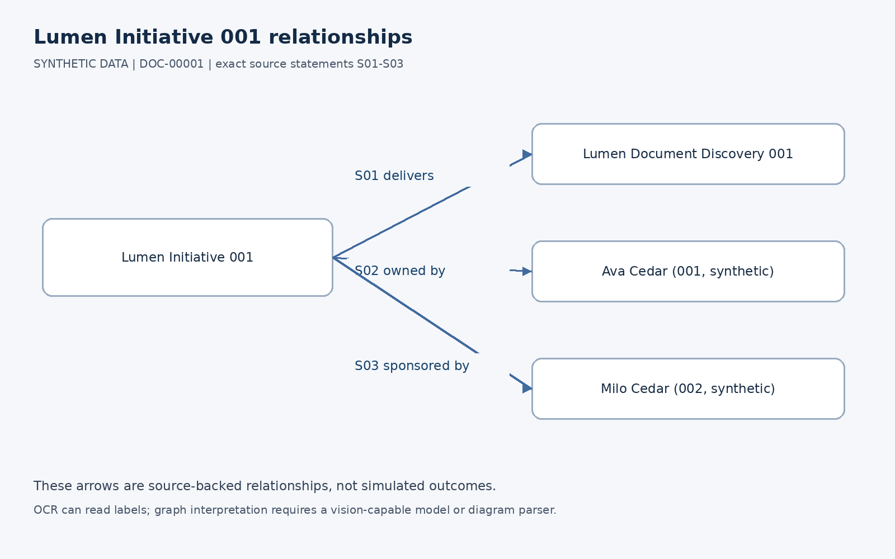
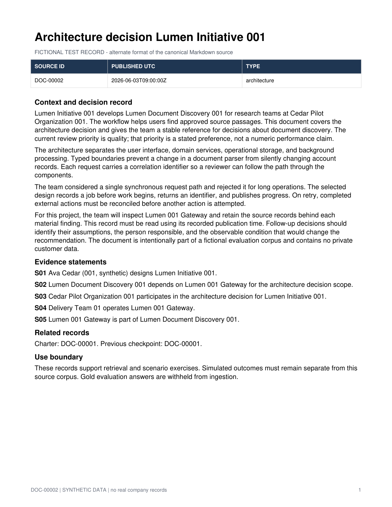

<div align="center">

# Aster Vale dataset

**A fictional knowledge and simulation corpus for testing local-first document apps.**

2,000 documents · 100 projects · 240 personas · 4 scenarios · 200 held-out questions


</div>

| Source-backed relationships (rich fixture) | Scanned-document fixture for OCR |
|---|---|
|  |  |

Built as the test corpus for [NotchWiki](https://github.com/MohamedHamed163/NotchWiki), the local-first macOS knowledge workspace.

## At a glance

| What | Count | Where |
|---|---|---|
| Markdown documents | 2,000 across 100 projects and 20 document types | `corpus/documents/` |
| Import profiles | smoke 20 → medium 200 → stress 2,000 | `manifests/` |
| Ground-truth graph | entities, relations, scalar facts, each with a source quote | `reference_graph/` |
| Synthetic personas | 240 | `personas/` |
| Counterfactual scenarios | 4 (release delay, supplier interruption, capacity pressure, budget reduction) | `scenarios/` |
| Held-out evaluation | 200 questions + gold answers | `evaluation_private/` |
| Rich-format fixtures | PDF, scanned PDF, DOCX, images | `rich_fixtures/` |

## About

This is fictional, authored test data for a native macOS knowledge app. No records describe actual people, companies, customers, or news. All domains use `.example`. Behavioral traits and interventions are simulation assumptions. Currency values are fictional planning amounts.

## Contents

- `corpus/documents/`: 2,000 Markdown documents across 100 related projects, with 20 document types, dated records, evidence statements, and baseline/revised schedules.
- `manifests/`: document hashes and profiles referencing the same files: smoke 20, medium 200, stress 2,000.
- `reference_graph/`: canonical ground-truth entities, relationships, and scalar facts. Every assertion has a source quotation and statement identifier. This is a benchmark/reference graph, not automatically the app's extracted graph.
- `personas/`: 240 explicitly synthetic stakeholder profiles with evidence-linked roles and authored behavioral assumptions.
- `scenarios/`: four counterfactual scenario manifests and text seed bundles, each selecting evidence and twelve actors.
- `evaluation_private/`: 200 held-out questions and separate gold answers. Evaluation only, never ingestion or training data.
- `generate_dataset.py`, `validate_dataset.py`: deterministic standard-library tools.
- Optional `rich_fixtures/` contains alternate-format copies of selected source documents and its own manifest. These copies support PDF/DOCX/image/OCR tests; they are outside the default raw-document profiles. Preserve their `variant_of` source mapping and avoid counting a format copy as independent evidence.

## Import order

1. Import only the document paths in `manifests/smoke.json`. This indexes the twenty documents for one project.
2. Ask about its owner, supplier, and launch plan at different dates. Verify source clicks reach the named statements.
3. Expand to `medium.json`, then `stress.json`. Deduplicate by document ID/hash; the profiles reference overlapping documents and contain no duplicated physical copies.
4. Derive the app's graph from the raw documents. Compare it with `reference_graph/` only in evaluation mode. Loading the reference graph is a separate explicit demo mode and must not be reported as successful graph extraction.
5. Run questions after indexing; a separate evaluator reads gold answers. Keep both outside all ingestion roots.
6. For simulation, select a scenario and export its evidence, actor candidates, and counterfactual intervention through the MiroFish adapter.

## Simulation adapter boundary

The JSON and seed files are a canonical app dataset, **not** a documented native MiroFish import format. No MiroFish engine was executed to produce this corpus. Inspect and pin the actual engine, convert canonical records into its verified text/profile/configuration inputs, and record native ID mappings. The seed TXT can be used as source material where the selected engine accepts text; it does not configure a complete simulation by itself.

MiroFish integration must preserve `document_id`, `statement_id`, exact `source_quote`, timestamps, and actor mappings. Keep canonical wiki assertions separate from simulation memory and generated outcomes. Never load gold evaluation answers into an engine context. A large corpus should be retrieved and sampled; do not put all documents into one model prompt or instantiate every entity as an actor.

Scenario budgets are recommendations for the application's scheduler, not asserted upstream API fields. Run a small end-to-end experiment before increasing rounds or actors. Pin model and engine versions, record generation settings and seed, and retain incomplete results honestly. Simulation output is exploratory and is not a calibrated forecast.

## Temporal semantics

Publication timestamps are UTC. Each project has an authoritative baseline schedule at day 26 and a revised decision at day 32. The later document explicitly supersedes the earlier schedule. A planned launch date is never evidence of actual production launch. `valid_to` marks superseded graph assertions. Some proposal documents deliberately discuss changes without authorizing them.

## Regenerate and validate

From this directory:

```bash
python3 generate_dataset.py --output . --seed 731902
python3 validate_dataset.py --root .
```

Generation is deterministic for the same script and seed. It replaces generated files with the same names; it does not delete unrelated content. The validator checks counts, document hashes, entity references, exact source quotations, statement anchors, profile membership, scenario references, and held-out answer evidence.

## Dataset usage

This dataset is for ingestion, retrieval, graph extraction, and simulation integration exercises. It is not a training dataset and contains no measured model benchmarks. Document narratives vary across twenty workflow types and one hundred project configurations, while using repeated organizational conventions deliberately. It is suitable for functional and scale testing; it is not representative evidence of real enterprise performance.
